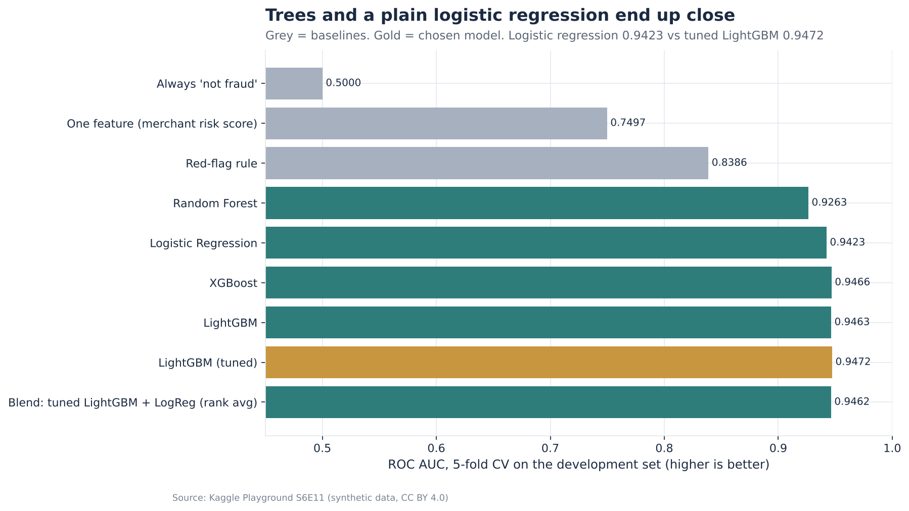
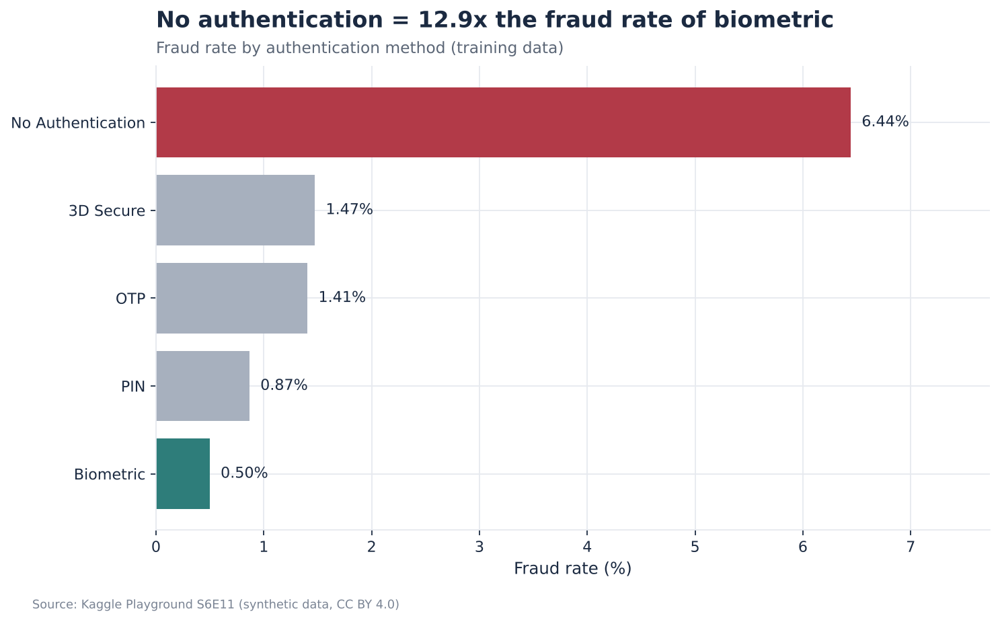
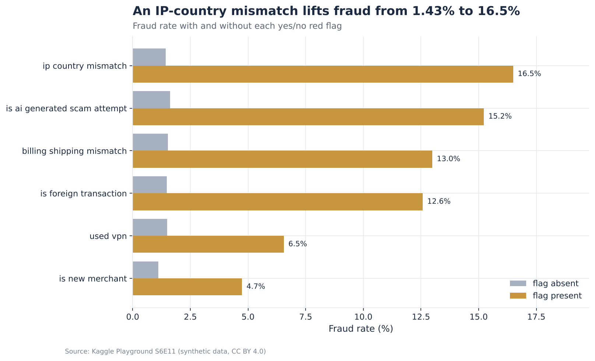
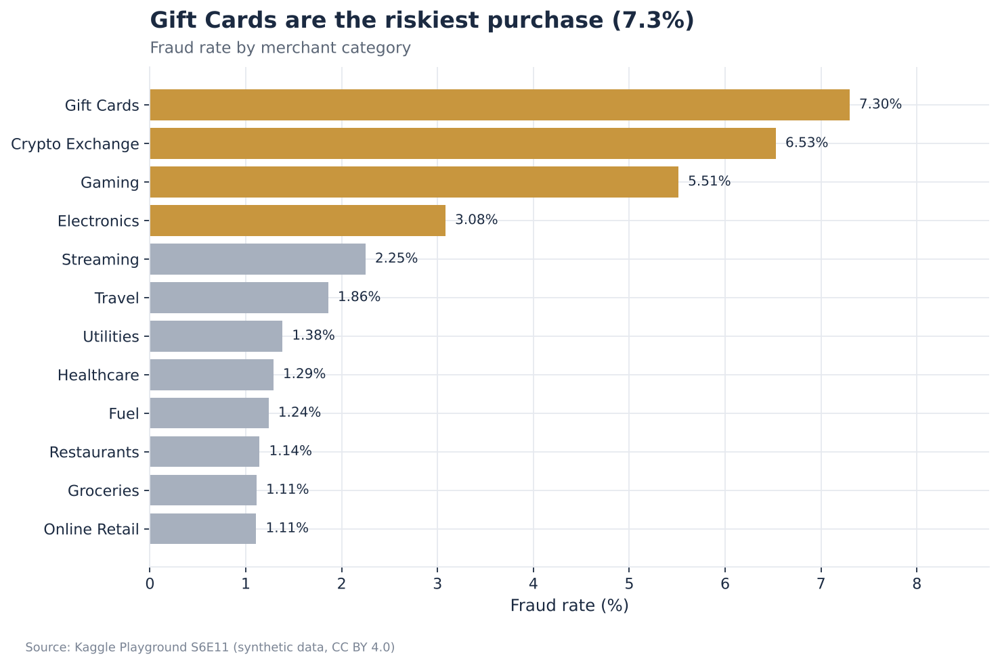
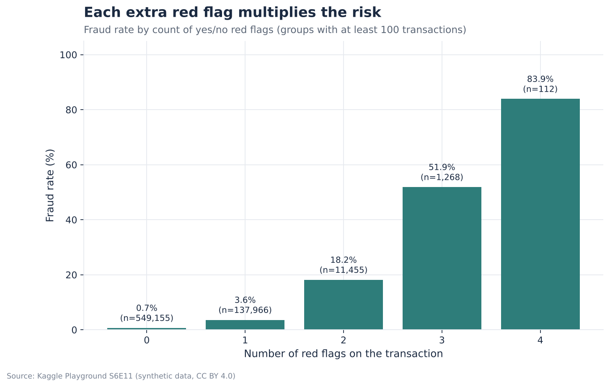
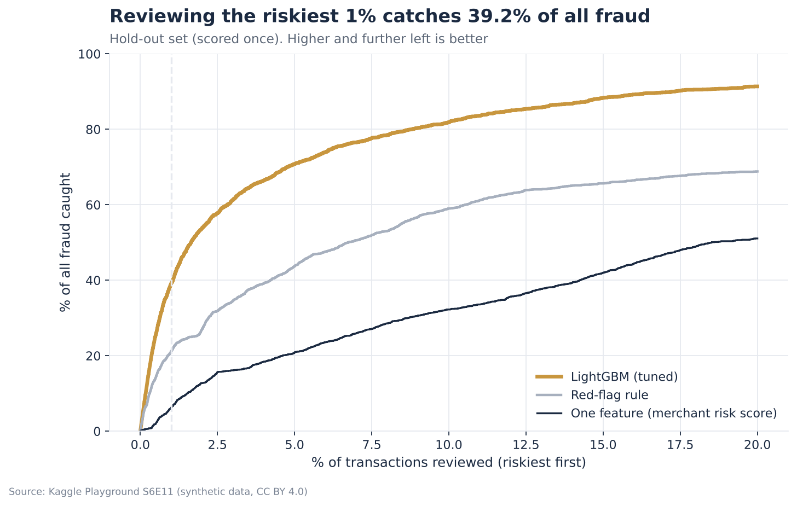
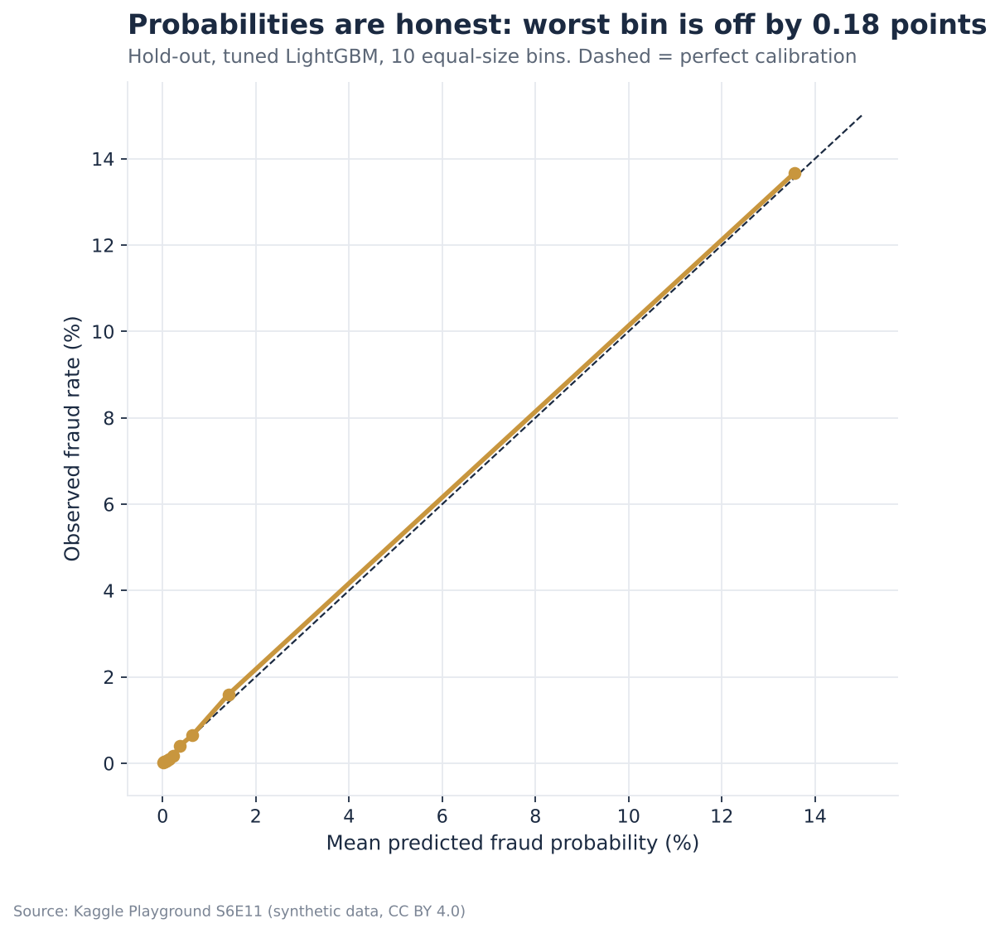
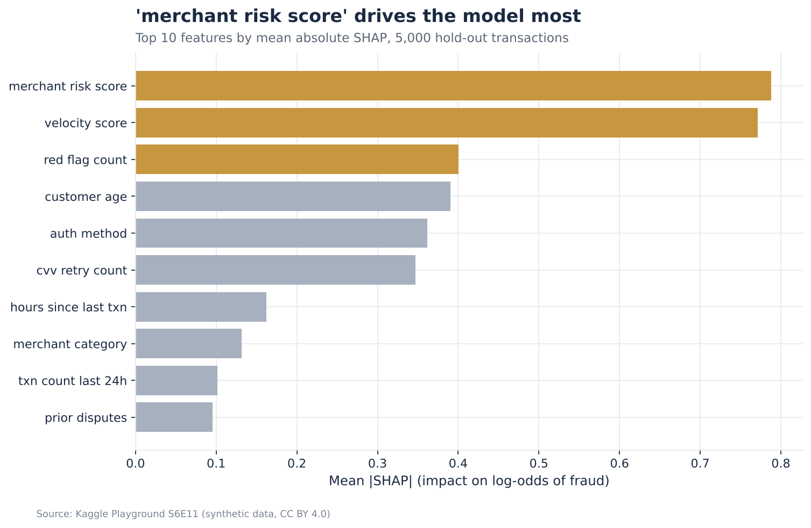

# Catching credit-card fraud — an honest model for Kaggle Playground S6E11

> ⚠️ **Synthetic data.** Kaggle generated this competition's data from another dataset. Every pattern below describes
> the generated data, not a real bank's customers.

Predict the probability that a card transaction is fraud. Only **1.67%** of transactions are fraud, so a
model that always says "not fraud" is **98.33% accurate** and completely useless —
which is why this project reports ROC AUC, PR AUC and "how much fraud do you catch if you review the riskiest 1%".

**Headline (locked 20% hold-out, scored once):** ROC AUC **0.9460**, PR AUC **0.520**.
Reviewing the riskiest 1% of transactions catches **39.2%** of all fraud, and
**65.4%** of the reviewed cases are real fraud (39.2x the base rate).
A hand-made red-flag rule gets ROC AUC 0.8471 and catches 21.2% at the same effort.

**Kaggle public leaderboard:** 0.94786 (scored by Kaggle on ~20% of the test set, checked on 2026-11-24; the private score is only revealed after the competition ends). The #1 public score at that time was 0.97051, so this is a solid, honest baseline, not a top-of-leaderboard entry.



## What the data says
1. Transactions with **no authentication** are fraud 6.44% of the time vs 0.5% with biometrics (12.9x).
2. An **IP-country mismatch** lifts the fraud rate from 1.43% to 16.5%.
3. **Gift Cards** are the riskiest purchase category (7.3%); Online Retail the safest (1.11%).
4. With zero red flags the fraud rate is 0.7%; with three or more it is **54.62%** (0.2% of transactions).
5. The strongest single number is `merchant_risk_score` (AUC 0.7489 alone). Time of day carries almost nothing (AUC 0.5002).
6. The dataset even has an `is_ai_generated_scam_attempt` flag: 2,299 transactions, 15.22% of them fraud.

| | |
|---|---|
|  |  |
|  |  |

## Data and cleaning
* 699,960 training rows, 299,984 test rows, 24 raw columns. Licence: CC BY 4.0 (Kaggle).
* Checks: 0 missing values, 0 duplicate rows, 0 training rows identical to a test row → **no rows removed**.
* Booleans → 0/1, categories kept as categories, plus four row-level features (`red_flag_count`, `amount_to_balance`, `log_amount`, `is_night`).

## How it was validated (and how leakage was prevented)
* There is **no date column**, so there is no future to protect; a time split would be invented. Stratified K-fold is used instead.
* **139,992 rows (20%)** were locked away as a hold-out and scored once. All choices used 5-fold CV on the other 559,968.
* No target encoding, no statistics from the test set, `id` is never a feature. Scaling / one-hot live inside a scikit-learn Pipeline, so they are fit per fold.
* [`tests/test_no_leakage.py`](tests/test_no_leakage.py) checks: features are row-level only (other rows can't change them), features don't use the target,
  hold-out and folds never overlap, preprocessing is inside the pipeline, and no training row appears in the test set.

## Results
### 5-fold CV on the development set (used for every choice)
| Model | ROC AUC | PR AUC | Fraud caught (top 1%) | Precision (top 1%) | Accuracy @0.5 |
|---|---:|---:|---:|---:|---:|
| Always 'not fraud' | 0.5000 | 0.017 | 0.9% | 1.5% | 98.33% |
| One feature (merchant risk score) | 0.7497 | 0.053 | 7.2% | 12.0% | — |
| Red-flag rule | 0.8386 | 0.196 | 20.2% | 33.7% | — |
| Logistic Regression | 0.9423 | 0.487 | 37.4% | 62.5% | 98.65% |
| Random Forest | 0.9263 | 0.426 | 34.1% | 57.0% | 98.54% |
| XGBoost | 0.9466 | 0.503 | 38.6% | 64.4% | 98.66% |
| LightGBM | 0.9463 | 0.502 | 38.5% | 64.3% | 98.67% |
| LightGBM (tuned) | 0.9472 | 0.509 | 38.8% | 64.8% | 98.67% |
| Blend: tuned LightGBM + LogReg (rank avg) | 0.9462 | 0.507 | 38.4% | 64.2% | — |

XGBoost (0.9466) and LightGBM (0.9463) were practically tied before tuning;
LightGBM was tuned because it trained faster in these runs. Optuna (20 trials, 3-fold CV) moved LightGBM's CV AUC from 0.94630 to 0.94719.
Chosen on CV: **LightGBM (tuned)** (CV AUC 0.94719).

### Locked hold-out (scored once)
| Model | ROC AUC | PR AUC | Fraud caught (top 1%) | Precision (top 1%) | Accuracy @0.5 |
|---|---:|---:|---:|---:|---:|
| Always 'not fraud' | 0.5000 | 0.017 | 0.9% | 1.4% | 98.33% |
| One feature (merchant risk score) | 0.7457 | 0.051 | 6.2% | 10.4% | — |
| Red-flag rule | 0.8471 | 0.210 | 21.2% | 35.4% | — |
| Logistic Regression | 0.9405 | 0.497 | 38.4% | 64.1% | 98.68% |
| LightGBM (tuned) | 0.9460 | 0.520 | 39.2% | 65.4% | 98.70% |
| Blend: tuned LightGBM + LogReg (rank avg) | 0.9448 | 0.517 | 39.4% | 65.8% | — |

Honest notes: a plain logistic regression (hold-out AUC 0.9405) is close to the tuned LightGBM (0.9460).
Accuracy is shown only to make a point: always saying "not fraud" scores 98.33%, and the tuned model at a 0.5 threshold scores 98.70%.
The blend outputs ranks, not probabilities, so its accuracy is not meaningful.

**Share of all fraud caught vs share of transactions reviewed (hold-out):** 0.5%: **25.5%** | 1.0%: **39.2%** | 2.0%: **53.8%** | 5.0%: **70.8%** | 10.0%: **81.8%**

| | |
|---|---|
|  |  |

### Calibration
Tuned LightGBM on the hold-out: Brier score 0.01089 (a constant fraud-rate guess scores 0.01642).
In the riskiest tenth of transactions it predicts 13.55% fraud and 13.66% actually is;
the largest gap across the 10 bins is 0.18 percentage points.

### Explanation


| Case | Predicted | Actual | Amount | Merchant | Auth | Red flags | Top SHAP (+ raises risk, − lowers) |
|---|---:|---|---:|---|---|---:|---|
| caught_fraud | 74.13% | fraud | $49.12 | Gaming | No Authentication | 2 | red_flag_count (+), velocity_score (+), auth_method (+) |
| missed_fraud | 6.06% | fraud | $761.98 | Crypto Exchange | Biometric | 2 | merchant_risk_score (+), red_flag_count (+), auth_method (-) |
| false_alarm | 48.49% | not fraud | $36.61 | Gaming | 3D Secure | 1 | merchant_risk_score (+), velocity_score (+), red_flag_count (+) |

## Limitations
* **Synthetic data** — real fraud is messier, rarer in places, and changes over time (fraudsters adapt).
* No time column, so there is no "next month" test; a real deployment would need one.
* The 1% review threshold is an example. The right threshold depends on analyst capacity and the cost of a missed fraud vs a blocked customer.
* The extra "original" dataset that many competitors add to training was not used.

## Project structure
```
src/features.py        data checks + row-level features
src/modeling.py        hold-out & CV, baselines, models, metrics, Optuna, calibration
src/style.py           one chart theme
src/make_dashboard.py  offline Plotly dashboard (dashboard/fraud_dashboard.html)
src/make_readme.py     renders this README from results/metrics.json
notebooks/             main notebook (+ self-contained Kaggle version)
app/streamlit_app.py   results explorer + what-if scorer
tests/                 leakage tests
scripts/verify_numbers.py  checks every number in a text file exists in metrics.json
```

## How to run
```bash
pip install -r requirements.txt
# put train.csv and test.csv from the competition into data/
pytest -q tests/
jupyter nbconvert --to notebook --execute --inplace notebooks/fraud_model.ipynb
python src/make_readme.py && python scripts/verify_numbers.py README.md
streamlit run app/streamlit_app.py
```

## License
Code: MIT. Data: Kaggle Playground Series S6E11, CC BY 4.0 (not included in this repo).

---
Built by **Hussain Ahmed** · [GitHub](https://github.com/HussainAhmed75) · [Kaggle](https://www.kaggle.com/hussianahmed) · [Notebook on Kaggle](https://www.kaggle.com/code/hussianahmed/credit-card-fraud-honest-model-s6e11)
